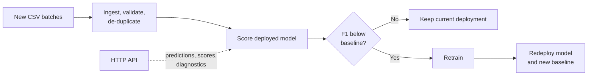

# Churn Model Monitoring

Automated monitoring for a deployed customer-churn model: it ingests new data,
checks whether model performance has dropped, and retrains and redeploys only
when it has.

| | |
| --- | --- |
| **Problem** | A model's accuracy can decline silently as new data arrives; retraining on a fixed schedule wastes effort, while never retraining lets quality erode. |
| **Approach** | A scheduled workflow ingests and de-duplicates new batches, scores the deployed model on them, and triggers retraining and redeployment only if the F1 score falls below the deployed baseline. An HTTP API exposes predictions, scores, data summaries, and runtime diagnostics. |
| **Results** | On the latest batches the deployed model scored F1 0.692, above its 0.571 baseline, so the workflow correctly kept the existing deployment instead of retraining. |
| **Stack** | Python · scikit-learn · pandas · Flask · cron |

## How it works



1. `ingestion.py` discovers configured CSV batches, validates their schema,
   removes duplicate records, and writes an ingestion manifest.
2. `scoring.py` evaluates the persisted logistic-regression model.
3. `fullprocess.py` compares performance on the new data with the deployed
   score and retrains and redeploys only when it has declined.
4. `app.py` serves predictions, model scoring, summary statistics, and runtime
   diagnostics over HTTP.
5. `reporting.py` produces a confusion matrix for the deployed model.

## Key design decisions

- **Retrain on evidence, not on a timer.** Retraining runs only when F1 on
  newly labeled data drops below the deployed baseline, which avoids needless
  model churn.
- **Ingest idempotently.** A manifest of ingested files and record-level
  de-duplication keep repeated runs from double-counting data.
- **Separate staging from deployment.** Training writes to a model folder;
  only the redeployment step copies artifacts and the new baseline into the
  deployment folder.
- **Make operations observable.** Diagnostics report summary statistics,
  missing-data rates, step timings, and dependency versions through the API.

## Results

| Measure | Value |
| --- | ---: |
| Deployed model baseline F1 | 0.571 |
| F1 on the latest ingested batches | 0.692 |
| Decision | Keep the current deployment |

The saved API responses and confusion matrices in `models/` capture this state.

## Limitations

- The trigger monitors predictive performance on labeled batches. It does not
  test feature-distribution shift, so the response status `new_data_no_drift`
  means only that F1 did not fall below the baseline.
- The Flask server has no authentication and is intended for local or
  controlled use; add authentication and restrict file access before exposing
  it to an untrusted network.
- Datasets are small, and the model is a logistic-regression baseline.

## Running locally

```bash
pip install -r requirements.txt
python app.py                # start the API
python apicalls.py           # in a second terminal: call every endpoint
python fullprocess.py        # run ingestion, scoring, and conditional redeployment
```

`config.json` points the workflow at `sourcedata/`; `config.test.json` points
it at the smaller `practicedata/` sample. `cronjob.txt` shows an example
ten-minute schedule.

## Repository structure

```text
.
├── ingestion.py, training.py, scoring.py   # Data and model steps
├── deployment.py, fullprocess.py           # Conditional redeployment workflow
├── diagnostics.py, reporting.py            # Diagnostics and confusion matrix
├── app.py, apicalls.py, wsgi.py            # HTTP API and client
├── sourcedata/, practicedata/, testdata/   # Input and evaluation data
├── models/, practicemodels/                # Trained models and saved outputs
└── production_deployment/                  # Currently deployed model and baseline
```
